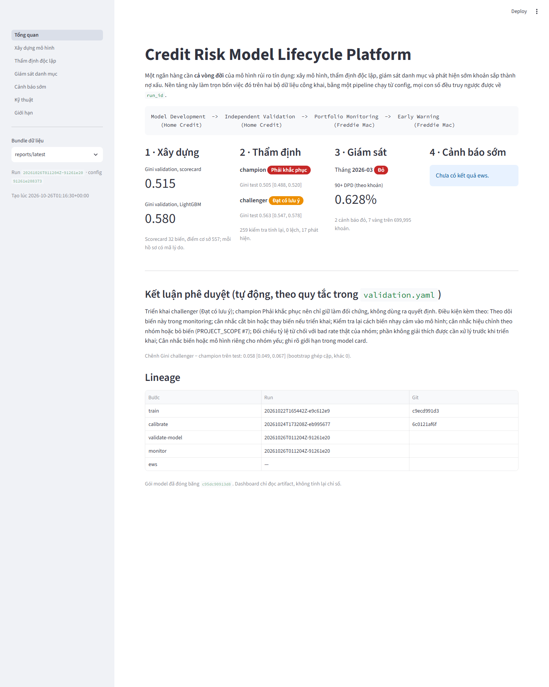

# bank-credit-risk-platform

> **English summary.** An end-to-end credit risk model lifecycle on public data: a PD scorecard with a LightGBM
> challenger (Home Credit), an independent validation engine that recomputes every metric from a frozen model
> package and issues an automated approve / remediate verdict, portfolio monitoring with vintage curves, roll rates
> and alerts, and a 3-month early warning system with a capacity-based watchlist (Freddie Mac, 35.6M loan-months).
> One command runs the nine-step pipeline from YAML config; every number traces back to a `run_id`, a config hash
> and a git commit. A Streamlit dashboard reads the artifacts and follows the business decision flow.

Nền tảng bao quát toàn bộ **credit risk model lifecycle**: từ một PD scorecard và một machine learning challenger,
đến independent validation, portfolio monitoring và Early Warning System cho các khoản vay có nguy cơ chuyển sang
90+ DPD.

```
Model Development  ->  Independent Validation  ->  Portfolio Monitoring  ->  Early Warning
   (Home Credit)            (Home Credit)                (Freddie Mac)            (Freddie Mac)
```

## Bốn câu hỏi, bốn câu trả lời

| Câu hỏi nghiệp vụ | Câu trả lời của nền tảng |
|---|---|
| **Hồ sơ này rủi ro tới mức nào, từ chối thì vì sao?** | Scorecard 32 biến trên WoE (điểm cơ sở 557, PDO 20), Gini validation 0.515; LightGBM challenger Gini 0.580. Mỗi hồ sơ có điểm theo từng biến và 4 mã lý do; PD đã calibrate (Platt, slope 1.00). |
| **Mô hình có đủ điều kiện phê duyệt không?** | Engine thẩm định đọc gói đóng băng, tính lại 259 kiểm tra (0 lệch), bootstrap 1,000 lần, PSI, phân khúc kể cả nhóm nhạy cảm. Kết luận tự động: **champion Phải khắc phục** (AIR 0.56 cho người dưới 30 tuổi), **challenger Đạt có lưu ý**; khuyến nghị triển khai challenger kèm điều kiện. Test Gini 0.505 [0.488, 0.520] so với 0.563 [0.547, 0.578]. |
| **Danh mục đang xấu đi ở đâu?** | Tháng 2026-03: chỉ số tháng xanh nhưng trạng thái **đỏ**, vì lứa 2023-2024 có default ở cùng MOB cao gấp khoảng 3 lần lứa 2012-2016. Vintage curve, roll rate, ma trận dịch chuyển theo giai đoạn COVID, tập trung rủi ro; 38 kiểm tra, 0 lệch. |
| **Khoản nào sắp vào 90+ DPD?** | Nhãn 90+ trong 3 tháng trên toàn panel, feature chỉ từ dòng ≤ t, chia theo thời gian. Out-of-time 2022-2025: watchlist top 5% mỗi tháng bắt được **90.3%** sự kiện (lift 18); với khoản đang current là 51.5%. Watchlist 2026-03: 16,159 khoản kèm reason code. |

Mọi con số ở trên nằm trong `reports/latest/` sau khi chạy pipeline, và hiện trên dashboard.

## Xem trong mười phút

1. **Dashboard** (đọc artifact, không tính lại gì):

   ```powershell
   streamlit run app/app.py
   ```

   Bảy trang theo luồng quyết định: Tổng quan → Xây dựng mô hình (một hồ sơ cụ thể với điểm từng biến) → Thẩm định
   (kết luận, khoảng tin cậy, PSI, fairness, so sánh hai mô hình) → Giám sát danh mục (vintage, roll rate, cảnh báo)
   → Cảnh báo sớm (watchlist, capture theo công suất) → Kỹ thuật (lineage) → Giới hạn.

   

2. **Báo cáo tự động** của từng module, sinh ra mỗi lần chạy: `validation_report.md` (mở đầu bằng kết luận phê duyệt và
   việc cần làm), `monitoring_report.md` (trạng thái, cảnh báo, mọi quy tắc), `ews_report.md` (kết quả chính và
   watchlist), model card của scorecard.

3. **Tổng kết từng chặng** trong `docs/`: mỗi file ghi quyết định, kết quả trên dữ liệu thật, bằng chứng Definition of
   Done và giới hạn. Bài viết tổng kết toàn project: [docs/summary.md](docs/summary.md).

## Tài liệu

- Phạm vi, quyết định đã chốt và các giới hạn: [PROJECT_SCOPE.md](PROJECT_SCOPE.md)
- Cách tải dữ liệu: [data/README.md](data/README.md)
- Chất lượng dữ liệu: [Home Credit](docs/data_quality_home_credit.md), [Freddie Mac](docs/data_quality_freddie_mac.md)
- Stage 2, WoE / IV và danh sách biến: [docs/stage2_woe_iv.md](docs/stage2_woe_iv.md)
- Stage 3, scorecard: [docs/stage3_scorecard.md](docs/stage3_scorecard.md)
- Stage 4, LightGBM challenger: [docs/stage4_lightgbm.md](docs/stage4_lightgbm.md)
- Stage 5, calibration và model package: [docs/stage5_calibration.md](docs/stage5_calibration.md)
- Stage 6, validation engine (thẩm định độc lập): [docs/stage6_validation.md](docs/stage6_validation.md)
- Stage 7, validation report tự động có kết luận: [docs/stage7_validation_report.md](docs/stage7_validation_report.md)
- Stage 8, portfolio monitoring (Freddie Mac): [docs/stage8_monitoring.md](docs/stage8_monitoring.md)
- Stage 9, survival và Early Warning System: [docs/stage9_early_warning.md](docs/stage9_early_warning.md)
- Stage 10, dashboard và demo: [docs/stage10_platform_demo.md](docs/stage10_platform_demo.md)
- Định nghĩa nghiệp vụ (single source of truth): [configs/definitions.yaml](configs/definitions.yaml)

## Trạng thái

| Chặng | Nội dung | Trạng thái |
|---|---|---|
| 1 | Nền móng: repo, môi trường, data contract, định nghĩa, ingest, data validation, test lõi | Dữ liệu thật đã qua validate: Home Credit (135 check, 0 error), Freddie Mac 2012-2025 (0 error) |
| 2 | WoE / IV, binning, rà soát leakage | **Xong** (tag `v0.2-woe-iv`): 45 biến, bảng bin tái lập được và chỉ học trên train. [Tổng kết](docs/stage2_woe_iv.md) |
| 3 | Scorecard | **Xong**: 32 biến, điểm nguyên (BaseScore 600, odds 50:1, PDO 20), Gini validation 0.515, mã lý do, model card. [Tổng kết](docs/stage3_scorecard.md) |
| 4 | LightGBM challenger | **Xong**: 192 biến, 30 cấu hình có log, SHAP; Gini validation 0.580 (+0.064 so với champion, lạc quan). [Tổng kết](docs/stage4_lightgbm.md) |
| 5 | Calibration, đóng băng model | **Xong**: Platt cho cả hai mô hình (chọn bằng CV), slope validation 1.00 / 1.01; model package fingerprint `c95dc90913d8` (đổi cách băm ở chặng 6.0, trước là `35e42a5f208b`). [Tổng kết](docs/stage5_calibration.md) |
| 6 | Validation engine | **Xong** (tag `v0.6-validation`): một lệnh tính lại mọi chỉ số từ gói đóng băng, 252 kiểm tra, 0 lệch, 17 phát hiện; test Gini 0.505 / 0.563; `metrics.json` + báo cáo. [Tổng kết](docs/stage6_validation.md) |
| 7 | Validation report tự động | **Xong**: 11 quy tắc trong `validation.yaml` cho kết luận từng mô hình (champion Phải khắc phục: AIR 0.56 cho người dưới 30; challenger Đạt có lưu ý) và khuyến nghị (triển khai challenger kèm điều kiện); so sánh hai mô hình; báo cáo mở đầu bằng kết luận, việc cần làm, giới hạn. [Tổng kết](docs/stage7_validation_report.md) |
| 8 | Portfolio monitoring | **Xong**: panel 35.6 triệu dòng dựng bằng DuckDB; chỉ số danh mục theo số khoản và dư nợ, vintage curve, roll rate / migration, phân khúc và tập trung; 38 kiểm tra, 0 lệch. 2026-03: chỉ số tháng xanh, nhưng trạng thái đỏ vì lứa 2023-2024 có default ở cùng MOB cao gấp khoảng 3 lần lứa 2012-2016. [Tổng kết](docs/stage8_monitoring.md) |
| 9 | Survival và EWS | **Xong**: nhãn 90+ trong 3 tháng trên toàn panel (SQL khớp tuyệt đối bản pandas), 34 feature chỉ từ dòng ≤ t, logistic baseline và LightGBM; 52 kiểm tra, 0 lệch. Out-of-time 2022-2025: watchlist top 5% mỗi tháng bắt được 90.3% sự kiện (51.5% với khoản đang current), lift 18. Watchlist 2026-03: 16,159 khoản kèm reason code. Survival: CIF default MOB 60 là 3.3%, trả trước 46.8%. [Tổng kết](docs/stage9_early_warning.md) |
| 10 | Dashboard, demo | **Xong**: bước `report` gom output mới nhất của mọi chặng thành một bundle có lineage (`reports/latest/`); dashboard Streamlit 7 trang chỉ đọc bundle; test DoD kiểm tra bundle tái lập được và mọi trang render được. [Tổng kết](docs/stage10_platform_demo.md) |

## Cài đặt (Windows, Python 3.13)

```powershell
python -m venv .venv
.venv\Scripts\Activate.ps1
python -m pip install -r requirements.txt
python -m pip install -e . --no-deps
copy .env.example .env
```

Kiểm tra:

```powershell
python -m pytest
python -m credit_risk check-config
```

Dữ liệu thô không nằm trong repo: xem [data/README.md](data/README.md). Không có dữ liệu thì bộ test vẫn chạy
(mỗi chặng có test Definition of Done trên dữ liệu tổng hợp), nhưng pipeline và dashboard thì cần dữ liệu thật.

## Chạy pipeline

```powershell
python -m credit_risk run                                  # đủ 9 bước, cả hai nguồn
python -m credit_risk run --steps ingest validate-data     # chỉ một số bước
python -m credit_risk run --source freddie_mac             # chỉ một nguồn
python -m credit_risk run --steps report                   # gom bundle mới nhất cho dashboard
streamlit run app/app.py                                   # dashboard
```

| # | Bước | Làm gì | Output |
|---|---|---|---|
| 1 | `ingest` | CSV / TXT thô → parquet đúng kiểu | `data/processed/<source>/*.parquet` |
| 2 | `validate-data` | Kiểm tra theo data contract; rule `error` fail thì dừng | `artifacts/<run_id>/data_validation/` |
| 3 | `features` | Split, availability matrix, bảng feature cấp hồ sơ, binning + WoE fit trên train, báo cáo IV, shortlist (M1); panel + biến trễ (M3) còn lại | `data/processed/home_credit/{splits,features}.parquet`, `binning.json`, `shortlist.json`, `artifacts/<run_id>/features/` |
| 4 | `train` | Scorecard: logistic trên WoE, loại biến sai / không ổn định dấu, quy đổi điểm, mã lý do, model card; LightGBM challenger: 30 cấu hình, early stopping, SHAP, so với champion (M1) | `data/processed/home_credit/{scorecard.json,scores.parquet,challenger.json,challenger_model.txt,challenger_scores.parquet}`, `artifacts/<run_id>/train/` |
| 5 | `calibrate` | Platt / isotonic trên calibration sample, chọn bằng CV; đóng băng model package | `data/processed/home_credit/model_package/`, `artifacts/<run_id>/calibrate/` |
| 6 | `validate-model` | Thẩm định độc lập gói đóng băng: tính lại AUC/Gini/KS, hiệu chỉnh, PSI, bootstrap, phân khúc, so sánh hai mô hình, chấm lại; áp quy tắc kết luận | `artifacts/<run_id>/validate-model/{metrics.json,validation_report.md}` |
| 7 | `monitor` | Panel giám sát, chỉ số danh mục hằng tháng, vintage curve, roll rate / migration, phân khúc, cảnh báo theo `ews.yaml` | `data/processed/freddie_mac/monitoring_panel.parquet`, `artifacts/<run_id>/monitor/{monitoring_metrics.json,monitoring_report.md,*.csv}` |
| 8 | `ews` | Nhãn 90+ trong 3 tháng (SQL, đối chiếu `labels.py`), feature tại t chỉ từ dòng ≤ t, logistic baseline + LightGBM challenger, chấm điểm mọi đoạn, watchlist theo công suất 5% kèm reason code, survival (Kaplan-Meier, Aalen-Johansen) | `data/processed/freddie_mac/{ews_labels,ews_dataset,ews_scores}.parquet`, `artifacts/<run_id>/ews/{ews_metrics.json,ews_report.md,watchlist.csv,*.csv,models/}` |
| 9 | `report` | Gom output mới nhất của mọi bước (train / calibrate / validate-model / monitor / ews) thành một bundle: `index.json` (run id từng phần, con số chính), báo cáo, bảng, ví dụ hồ sơ với điểm từng biến; sao chép sang `reports/latest/` | `artifacts/<run_id>/report/`, `reports/latest/` |

Mỗi lần chạy sinh một `run_id` (`<UTC time>-<config hash>`). File `artifacts/<run_id>/run_manifest.json` ghi lại config hash, seed, git commit, phiên bản thư viện và trạng thái từng bước. Bước `report` lấy train và calibrate đúng theo run mà validate-model đã thẩm định, nên dashboard không bao giờ ghép model của lần này với kết luận của lần khác.

## Cấu trúc

```
bank-credit-risk-platform/
├── configs/
│   ├── definitions.yaml          # DPD, default, cửa sổ, COVID, scaling, ngưỡng
│   ├── model_dev.yaml            # split, binning, champion / challenger
│   ├── validation.yaml           # bootstrap, PSI, segment, implementation check, quy tắc kết luận
│   ├── ews.yaml                  # vintage, time split, alert capacity, quyết định monitoring / EWS
│   ├── feature_availability.yaml # mỗi cột có mặt từ lúc nào: control chống leakage
│   └── data_contracts/           # data dictionary + rule kiểm tra cho từng nguồn
├── data/README.md                # chỉ hướng dẫn tải
├── docs/                         # data quality, tổng kết từng chặng, bài viết tổng kết, ảnh dashboard
├── src/credit_risk/
│   ├── data/                     # contracts, ingest, validate (DuckDB)
│   ├── features/                 # split.py, availability.py, build.py, binning.py, iv_report.py, selection.py, woe.py
│   ├── models/                   # scorecard.py (champion), challenger.py (LightGBM, SHAP), calibration.py
│   ├── validation/               # metrics.py, package, population, discrimination, calibration_check, stability,
│   │                             # uncertainty, segments, comparison, implementation, conclusion, engine.py
│   ├── monitoring/               # buckets, transitions, panel, portfolio, vintage, roll, concentration, alerts, engine.py
│   ├── ews/                      # labels (pandas reference), cohort, features, models, metrics, evaluation, watchlist, survival, engine.py
│   ├── reporting/                # model_card.py, challenger_report.py, calibration_report.py, bundle.py (bước report)
│   ├── pipeline.py               # 9 bước, run_id, manifest
│   └── cli.py
├── app/                          # dashboard Streamlit: app.py, common.py, views/ (7 trang), chỉ đọc reports/latest
├── tests/                        # metric, label, data validation, pipeline, config, DoD từng chặng (test_stage*_dod.py)
├── notebooks/  reports/          # notebook chỉ để khám phá; reports/latest do bước report sinh ra (gitignore)
└── artifacts/                    # sinh ra khi chạy, đã gitignore
```

## Nguyên tắc vận hành

1. **Config là single source of truth**: không hard-code ngưỡng hay định nghĩa trong code.
2. **Mọi kết quả có lineage**: truy được từ `run_id` về config hash và git commit.
3. **Mọi transformation chỉ fit trên train.**
4. **Time-based split là mặc định**, bắt buộc với dữ liệu panel. Home Credit là ngoại lệ có ghi nhận (không có ngày nộp đơn).
5. **Không commit dữ liệu thô.**
