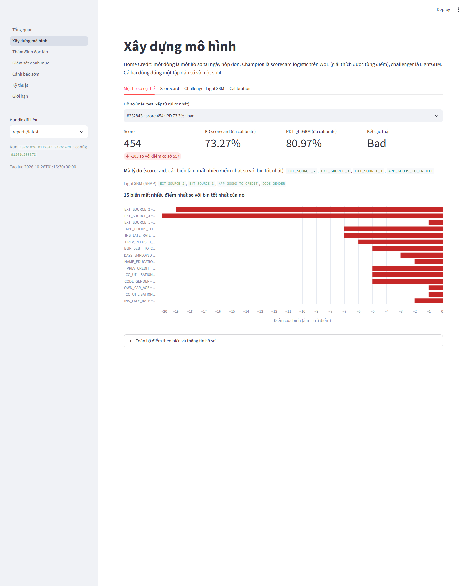
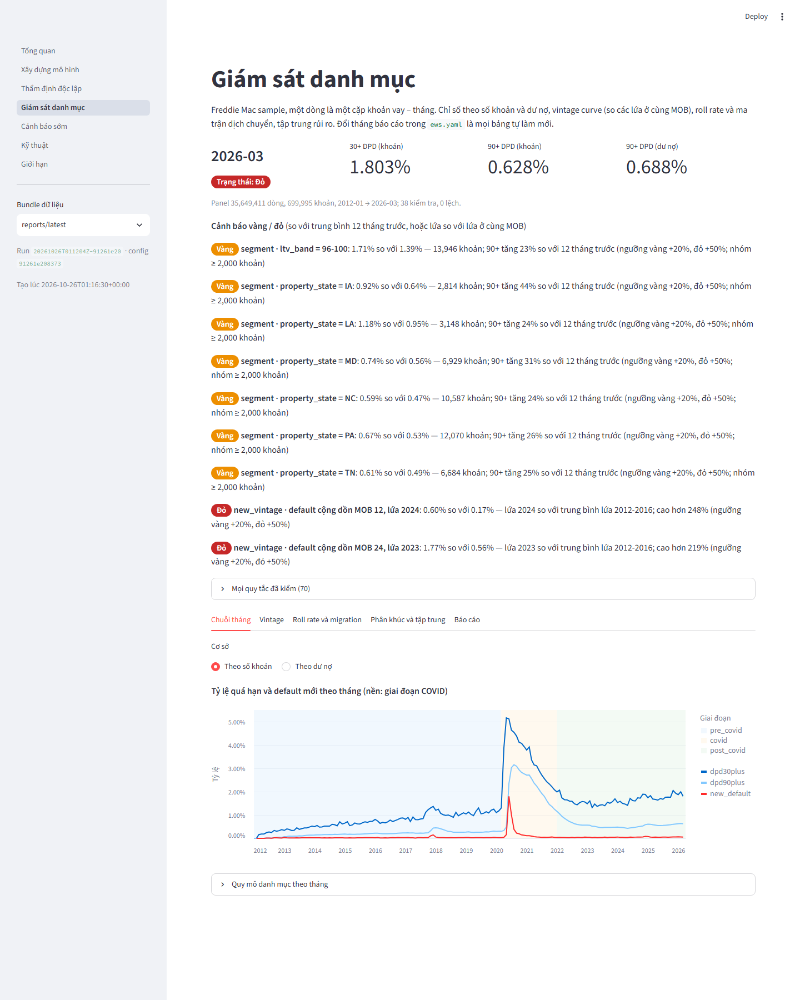

# Stage 10: nền tảng và demo

Chặng cuối của roadmap: biến chín bước pipeline và chín chặng trước thành thứ một người lạ hiểu được trong chưa tới
mười phút. Sản phẩm: bước `report` (bundle có lineage cho dashboard), dashboard Streamlit bảy trang, README viết lại
cho người đọc portfolio, bài viết tổng kết, ảnh chụp màn hình, test Definition of Done.

## 1. Quyết định

| # | Vấn đề | Quyết định | Lý do |
|---|---|---|---|
| 1 | Dashboard lấy số ở đâu | Chỉ đọc một **bundle** do bước `report` sinh ra; không đọc parquet, không tính lại chỉ số | Mọi con số trên màn hình phải là con số đã có trong artifact có `run_id`; dashboard không được trở thành một nguồn sự thật thứ hai |
| 2 | Bundle gồm run nào | validate-model mới nhất, rồi train và calibrate **đúng theo provenance của run đó** (`train_run_id`, `package_run_id`); monitor và ews lấy run thành công mới nhất của bước đó; bước chạy trong cùng pipeline run được ưu tiên | Không bao giờ ghép mô hình của lần này với kết luận của lần khác |
| 3 | Thiếu một module | Ghi vào `index.json` → `missing`, dashboard nói rõ "chưa có kết quả"; bước chỉ thất bại khi không có gì cả | Thà trống còn hơn bịa |
| 4 | Nơi dashboard mở mặc định | `reports/latest/` (bản sao của `artifacts/<run>/report/`), đổi được bằng sidebar, `?bundle=` hoặc `CREDIT_RISK_BUNDLE_DIR`; thư mục `reports/` theo máy qua `CREDIT_RISK_REPORTS_DIR` | Test với artifacts tạm không bao giờ ghi vào repo |
| 5 | Công cụ | Streamlit 1.66 + Altair (ghim trong `requirements.txt`), không matplotlib | Đúng OVERVIEW: giữ đơn giản; Altair có sẵn cùng Streamlit |
| 6 | Thứ tự trang | Theo kịch bản demo ba phút của OVERVIEW 7.1: Vấn đề → Xây dựng → Thẩm định → Giám sát → Cảnh báo sớm → Kỹ thuật → Giới hạn | Đi theo luồng quyết định nghiệp vụ, không theo thứ tự file |
| 7 | Ngôn ngữ | Tiếng Việt như toàn bộ tài liệu, thuật ngữ giữ tiếng Anh; README có tóm tắt tiếng Anh ở đầu | Người đọc portfolio có thể không đọc tiếng Việt |

## 2. Bước `report`

`src/credit_risk/reporting/bundle.py`, nối vào `pipeline.py` thay cho stub cũ.

```
artifacts/<run_id>/report/
├── index.json            bundle_version, run_id, config_hash, runs{train,calibrate,validate-model,monitor,ews},
│                         run_manifests (git, python, packages của từng run), missing, files, headline
├── development/          model_card.md, scorecard_table.csv, performance.json, sign_trail.csv, challenger_report.md,
│                         challenger_importance.csv, challenger_performance.json, challenger_trials.csv,
│                         calibration_report.md, calibration.json, package.json, applicant_examples.json
├── validation/           metrics.json, validation_report.md
├── monitoring/           monitoring_metrics.json, monitoring_report.md, portfolio_monthly / vintage_curves(_year) /
│                         roll_rates / alerts / concentration / segments_monthly / checks .csv
└── ews/                  ews_metrics.json, ews_report.md, watchlist / by_split / monthly_lists / calibration / segments /
                          survival_curves / importance / coefficients / cohort_by_split / trials / checks .csv
```

`applicant_examples.json` là phần duy nhất bước này tính thêm: 12 hồ sơ test trải đều theo PD (rủi ro nhất trước,
chọn tất định bằng `example_rows`), mỗi hồ sơ có điểm từng biến (giá trị, bin, điểm, điểm tốt nhất, điểm mất), mã
lý do của scorecard và của LightGBM (SHAP), PD đã calibrate của cả hai mô hình. Điểm được lấy từ chính gói đóng băng
qua `validation.package`, nên `base + Σ điểm = score` đúng từng hồ sơ (có test).

`headline` trong `index.json` là con số cho trang Tổng quan: Gini validation hai mô hình; kết luận, Gini test với CI,
số kiểm tra / lệch / phát hiện, khuyến nghị; tháng báo cáo, trạng thái, 90+, cảnh báo đỏ; mô hình EWS, capture và lift
out-of-time, kích thước watchlist.

Trên dữ liệu thật: 25 file (chưa có ews, xem mục 6), khoảng 10-50 giây tuỳ cache; manifest ghi đủ đầu ra.

## 3. Dashboard

`app/app.py` dùng `st.navigation`; mỗi trang là một hàm `render(bundle)` trong `app/views/`; `app/common.py` tìm
bundle và đọc file có cache theo mtime.

| Trang | Trả lời câu gì | Nguồn trong bundle |
|---|---|---|
| Tổng quan | Vấn đề; bốn câu trả lời với con số chính; kết luận phê duyệt; lineage | `index.json` → headline, runs |
| Xây dựng mô hình | *Một hồ sơ cụ thể* bị trừ điểm vì đâu (biểu đồ điểm theo biến, mã lý do, PD hai mô hình, kết cục thật); bảng điểm; decile; challenger (SHAP); calibration (reliability) | development/ |
| Thẩm định độc lập | Kết luận từng mô hình và khuyến nghị trước; rồi AUC/Gini/KS với CI, chênh lệch có ý nghĩa; hiệu chỉnh theo band; PSI; fairness (AIR, đường 0.8); hai mô hình (swap set, cùng khối lượng); phát hiện theo mức; báo cáo | validation/metrics.json |
| Giám sát danh mục | Trạng thái và cảnh báo vàng / đỏ trước; chuỗi tháng có nền giai đoạn COVID; vintage curve theo lứa với slider MOB; roll rate; ma trận dịch chuyển theo giai đoạn; tập trung | monitoring/ |
| Cảnh báo sớm | Mô hình, capture và lift ở công suất, PR-AUC; watchlist lọc theo trạng thái / reason code và tải về; backtest theo đoạn và theo tháng; phân khúc; calibration; survival; mô hình | ews/ |
| Kỹ thuật | Lệnh chạy, chín bước, lineage của bundle (run, config hash, commit, Python, thư viện), nguyên tắc, kiểm thử, cấu trúc | `index.json` → run_manifests |
| Giới hạn | Giới hạn gom từ `limitations` của ba module; hướng đi tiếp | validation / monitoring / ews metrics |






## 4. README, bài viết, ảnh

- `README.md` viết lại: tóm tắt tiếng Anh, bảng "bốn câu hỏi, bốn câu trả lời" với con số thật, lộ trình xem trong
  mười phút (dashboard → báo cáo tự động → docs từng chặng), trạng thái mười chặng, cài đặt và chạy, cấu trúc.
- `docs/summary.md`: bài viết tổng kết theo luồng định nghĩa → ba module → chặng 10 → bài học → giới hạn.
- `docs/img/`: ảnh chụp dashboard bằng Chrome headless qua DevTools Protocol (1440 px, theme sáng trong
  `.streamlit/config.toml`).

## 5. Definition of Done: bằng chứng

`tests/test_stage10_dod.py` (14 test) chạy validate-model + report trên gói tổng hợp của `stage6_build`:

| Yêu cầu | Bằng chứng |
|---|---|
| Bundle lấy đúng run | `runs.calibrate == provenance.package_run_id`, `runs.train == provenance.train_run_id`; mọi file development / validation có mặt và được liệt kê |
| Thiếu module thì nói rõ | monitor và ews là `None`, file thiếu nằm trong `missing`, không có headline cho chúng; trang Giám sát và Cảnh báo sớm hiện cảnh báo, không lỗi |
| Headline khớp file gốc | số kiểm tra, mã kết luận champion lấy lại từ `metrics.json` |
| Hồ sơ mẫu khớp scorecard | `base + Σ điểm = score`, thứ tự biến, `lost = best − points ≥ 0`, mã lý do chỉ gồm biến có mất điểm, xếp từ rủi ro nhất |
| Tái lập | chạy `report` hai lần cho cùng `index.json` (trừ thời điểm, run id, manifest của run đang chạy) và cùng `applicant_examples.json` |
| `reports/latest` | là bản sao đúng của bundle, nằm cạnh artifacts tạm chứ không trong repo |
| Không có gì thì thất bại | artifacts trống → bước `report` failed, không tạo `reports/latest` |
| Chọn run | `latest_ok_run`: bỏ run failed, bỏ run chưa có manifest trừ khi là run hiện tại có thư mục bước |
| Mọi trang render | `AppTest.from_string` cho từng view, không exception, có tiêu đề; điểm vào `app.py` chạy với navigation và chọn đúng bundle theo `CREDIT_RISK_BUNDLE_DIR`; không có bundle thì app chỉ cách tạo |

`test_pipeline.py` cập nhật: chạy đủ chín bước trên dữ liệu tổng hợp, bước `report` giờ `ok` và để lại
`report/index.json` cùng `reports/latest`.

Toàn bộ: 424 test.

## 6. Giới hạn và việc còn lại

- Bundle hiện tại trên máy này **chưa có ews**: bước `ews` chạy lại cục bộ bị hệ điều hành dừng vì thiếu RAM (laptop
  7.4 GB, bước cần 3-4 GB trống và hơn 25 phút). Chạy riêng lúc máy rảnh rồi `--steps report`:

  ```powershell
  python -m credit_risk run --steps ews --source freddie_mac
  python -m credit_risk run --steps report
  ```

  Trang Cảnh báo sớm được test trên dữ liệu tổng hợp qua `test_stage9_dod` + bundle; chưa có ảnh chụp trên dữ liệu thật.
- Dashboard là demo đọc file cục bộ, không có xác thực, không deploy; đúng phạm vi "dashboard demo" của PROJECT_SCOPE.
- Bước `report` mất vài chục giây trên dữ liệu thật vì chấm lại tập test để chọn hồ sơ mẫu.

## 7. Tái lập

```powershell
python -m credit_risk run --steps validate-model monitor ews report
streamlit run app/app.py
python -m pytest tests/test_stage10_dod.py
```
